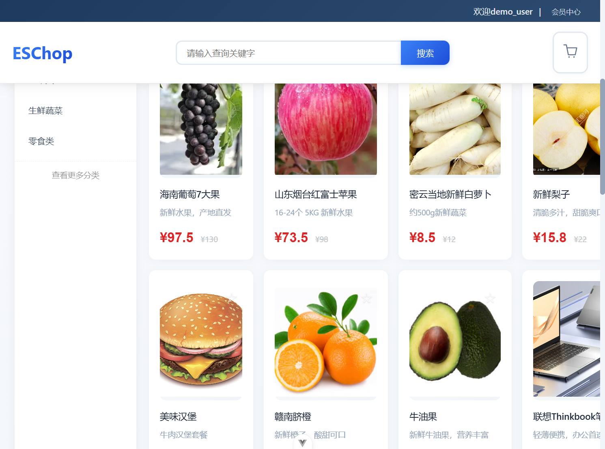
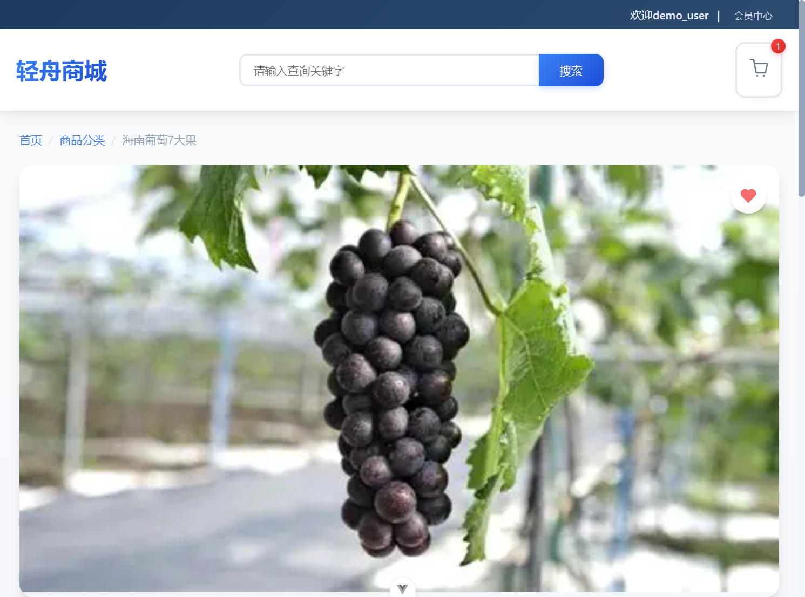
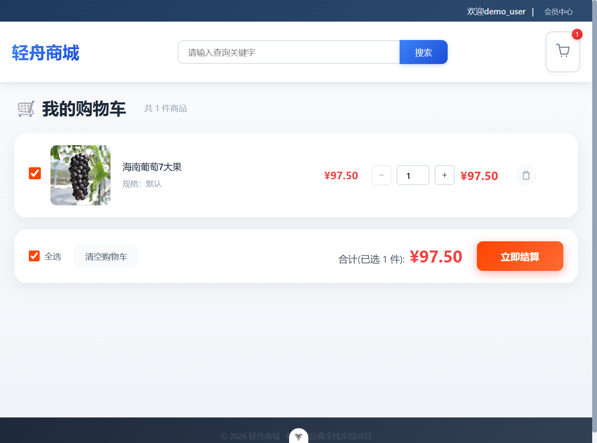
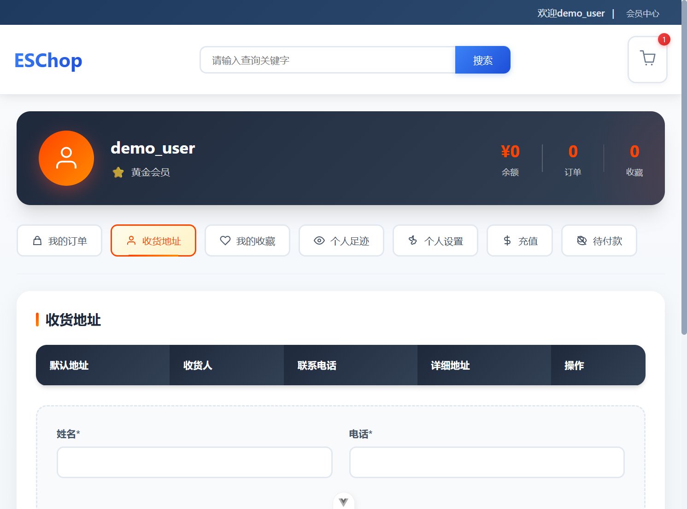

# 轻舟商城 (Qingzhou Mall)

> 前后端分离的 B2C 在线购物商城 —— 课外独立开发的全栈实践项目


## 项目简介

轻舟商城是一个覆盖完整购物流程的前后端分离 B2C 商城，包含用户前台（商品浏览、购物车、下单支付、收藏、地址管理）与后台管理（商品、订单、用户管理），后端围绕鉴权、限流、缓存与参数校验做了工程化安全加固。

开发全程借助 AI Agent（Claude Code / Trae）完成需求拆解、代码审查与 Bug 定位，形成"AI 生成 + 人工把关"的协作模式。

## 项目截图

| 商城首页 | 商品详情 |
| --- | --- |
|  |  |

| 购物车 | 用户中心 |
| --- | --- |
|  |  |

## 技术栈

| 层级 | 技术 |
| --- | --- |
| 前端框架 | Vue 3（Composition API）+ Vite |
| UI 组件库 | Element Plus + @element-plus/icons-vue |
| 状态管理 / 路由 | Pinia / Vue Router（路由守卫权限控制） |
| 网络请求 | Axios（请求/响应拦截器统一处理 Token 与错误） |
| 后端框架 | Node.js + Express 5（MVC 分层） |
| 数据库 / 缓存 | MySQL 8（mysql2 连接池） / Redis 5（热点数据缓存） |
| 鉴权 | JSON Web Token + bcrypt 密码加密 |

## 功能模块

**用户前台**
- 商品浏览 / 分类筛选 / 关键词搜索 / 商品图懒加载
- 购物车（增删改查、结算）
- 订单流程（下单、收货地址管理、模拟支付）
- 会员中心（资料、余额、收藏夹）
- 登录 / 注册（JWT 鉴权，密码 bcrypt 加密存储）

**后台管理**
- 商品管理（上下架、库存、分类）
- 订单管理 / 用户管理
- Redis 缓存管理接口

## 目录结构

```
qingzhou-mall/
├── src/
│   ├── api/                # Axios 封装与接口定义
│   ├── assets/ images/     # 静态资源
│   ├── components/         # 公共组件（Header / Footer / Loading）
│   ├── router/             # 路由与守卫
│   ├── stores/             # Pinia 状态管理
│   ├── views/              # 页面（首页/详情/购物车/订单/会员中心等）
│   ├── utils/              # 工具函数与前端日志
│   └── backend/            # Express 后端
│       ├── config/         # MySQL 连接池 / Redis 客户端
│       ├── controllers/    # 控制器
│       ├── models/         # 数据模型
│       ├── routes/         # 路由
│       ├── middleware/     # JWT 鉴权 / 参数校验 / 统一错误处理
│       ├── db/             # 建表 SQL 与迁移脚本
│       └── utils/logger.js # winston 日志
└── vite.config.js          # Vite 配置（生产分包 terser 压缩）
```

## 快速开始

### 环境要求

- Node.js ≥ 20.19 或 ≥ 22.12
- MySQL ≥ 8.0
- Redis ≥ 5.0（Windows 可用 [tporadowski/redis](https://github.com/tporadowski/redis) 5.0.14）

### 1. 安装依赖

```sh
npm install
```

### 2. 配置环境变量

复制 `.env.example` 为 `.env`，按本机环境修改数据库密码与 JWT 密钥：

```sh
cp .env.example .env   # Windows: copy .env.example .env
```

### 3. 初始化数据库

建表脚本会自动创建名为 `qingzhou_mall` 的数据库并导入 8 张表与演示数据：

```sh
mysql -u root -p < src/backend/db/qingzhou_8表.sql   # 建库建表 + 演示数据
node src/backend/db/migrate.mjs                      # 幂等迁移（4 表 → 8 表）
```

### 4. 启动服务

```sh
npm run server      # 后端 Express，默认 http://localhost:3001
npm run dev         # 前端 Vite 开发服务器，默认 http://localhost:5173
```

打开 http://localhost:5173 即可访问商城（开发模式下 Vite 将 `/api` 代理到后端 3001 端口）。

### 5. 演示账号

| 角色 | 用户名 | 密码 |
| --- | --- | --- |
| 管理员 | admin | admin123 |
| 普通用户 | demo_user | qingzhou123 |

## API 概览

所有接口以 `/api` 为前缀，返回统一 JSON 结构 `{ success, message, data }`。

| 模块 | 路由前缀 | 说明 |
| --- | --- | --- |
| 用户 | `/api/users` | 注册、登录、资料、余额 |
| 商品 | `/api/products` | 商品列表、详情、搜索 |
| 分类 | `/api/categories` | 商品分类 |
| 购物车 | `/api/cart` | 增删改查、结算 |
| 订单 | `/api/orders` | 下单、订单列表、详情 |
| 收藏 | `/api/favorites` | 收藏 / 取消收藏 |
| 地址 | `/api/addresses` | 收货地址管理 |
| 管理 | `/api/admin` | 商品 / 订单 / 用户管理 |
| 健康检查 | `/api/health` | 服务状态 |

## 安全特性

- **JWT 鉴权**：登录签发 Token，中间件统一校验
- **密码加密**：bcrypt 加盐哈希存储
- **安全响应头**：helmet（CSP / nosniff / X-Frame-Options 等）
- **接口限流**：express-rate-limit（15 分钟窗口默认 100 次）
- **参数校验**：express-validator 校验入参
- **HTTP 参数污染防护**：hpp
- **CORS 白名单**：区分开发 / 生产环境来源控制

## License

[MIT](LICENSE)
